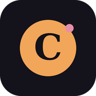

<div align="center">



# Cradlelog

**A calm, private feed and nappy log for new parents.**<br>
Built for two tired people, one hand free, at 3am. Self-hosted, installs on your phone, works offline.


</div>

---

## Why Cradlelog

Baby apps tend to want an account, a subscription and your child's data on someone else's server.
Cradlelog is the opposite: one small server you run yourself, one shared passcode for your family, and
no analytics, ads or third-party requests. The data is a single SQLite file you own.

It is designed around the question you actually ask in the dark: **"when was the last feed?"**
That number is the biggest thing on the screen.

## What it does

**Logging**
- Bottle and breast feeds, nappies (wee, poo, sick), notes and weigh-ins, each a tap or two.
- **Start a feed now and finish it later.** The clocks count from the start, not the end.
- **Continue feed** saves the amount so far and keeps the feed open, for a bottle that takes two sittings.
- Feed length is recorded when you finish. A feed left open for an hour ends itself at the last time the
  amount went up, because a prepared bottle can't be used after that. **Forgot to end** saves a feed with no length.
- **Undo instead of "are you sure?"**: saving and deleting happen straight away, with an 8 second Undo.

**Knowing where you are**
- A big "since last feed" clock and a smaller **next-feed countdown** based on your own "every X to Y hours" setting.
- Optional per-phone **alerts** when a feed is due, when it's overdue, and when a started feed ends with no amount.
- Today at a glance: millilitres, feeds, poos and wees.

**Trends**
- Last 24 hours against the day before, average feed size, average feed length, longest stretch between feeds.
- A "when feeds happen" chart, milk per day, feeds per day, and a weight chart (kg, or lb and oz).
- A daily breakdown table, over 7, 14 or 30 days.

**Built for real life**
- **Works offline.** Entries are queued on the phone and sync when the signal comes back.
- Shared by everyone with the passcode; changes reach the other phones within about half a minute.
- Dark by default, follows the phone's light or dark setting, 44px tap targets, and charts you can step through with the keyboard.
- Optional baby's name and date of birth in Settings (stored on your server only), a switch to hide the Breast
  button once you're on bottles, and CSV **export and import**.

## Quick start

You need a server with Docker and a domain name pointing at it.

```sh
git clone https://github.com/Neidraidd/cradlelog.git
cd cradlelog
cp .env.example .env        # then set PUBLIC_URL, for example https://cradlelog.example.com
docker compose up -d --build
```

Cradlelog serves plain HTTP on `127.0.0.1:8080` and expects a reverse proxy in front to provide HTTPS
(needed for installing it as an app and for alerts). With [Caddy](https://caddyserver.com) that is the whole config:

```
cradlelog.example.com {
    reverse_proxy 127.0.0.1:8080
}
```

Then **open your address straight away.** The first visit asks you to choose the family passcode
(8 characters or more). Until you do, whoever opens the page first gets to choose it, so don't leave a fresh
install unclaimed. Prefer no window at all? Set `CRADLELOG_PASSCODE` in `.env` and skip the screen.

Update later with `git pull && docker compose up -d --build`.

### Deploy on Coolify

Coolify builds straight from the repo's `Dockerfile` and handles HTTPS for you, so you don't need the Caddy step.

1. **New resource**, then **Public Repository** (or connect your GitHub app for a private fork), and paste the repo URL. Branch `main`.
2. **Build pack: Dockerfile.** Under **Ports Exposes** enter `8080`.
3. **Domains:** enter your address with `https://`, for example `https://cradlelog.example.com`.
4. **Environment variables:**
   - `PUBLIC_URL` = the same `https://` address as the domain (needed for secure cookies and HSTS).
   - `TRUST_PROXY` = `1` (Coolify's proxy sits in front of the app).
   - `CRADLELOG_PASSCODE` = your passcode, 8+ characters. Setting it here is recommended: Coolify makes the site
     public the moment it deploys, and this way nobody can claim a fresh install before you do. Mark it as a secret.
   - `CRADLELOG_TZ` = your timezone, for example `Europe/London` (optional).
5. **Persistent Storage:** add a **Volume Mount** with destination `/data`. Use a volume, not a directory bind mount:
   the app runs as a non-root user and a bind mount is owned by root, which stops the database being written. Without
   this storage your data is lost on every redeploy.
6. **Deploy.** For updates, push to GitHub and redeploy, or turn on auto-deploy and add Coolify's webhook to the repo.

If a CDN such as Cloudflare sits in front of Coolify, sign-in lockouts will see the CDN's address rather than each
visitor's, so one person's wrong guesses can lock everyone out. Leave the CDN proxy off for this app.

### Put it on your phone

Open your address in the phone's browser, then:

- **iPhone:** Share, then **Add to Home Screen**. Open it from the Home Screen icon. Alerts only work from there
  (iOS 16.4 or later).
- **Android:** browser menu, then **Install app**.

Each phone signs in once with the passcode and stays signed in. Settings has **Sign out of this phone**.

### Moving from another app, or backing up

- **Export:** Settings, then **Download all entries (CSV)**. This is the easy backup.
- **Import:** Settings, then **Import entries from a CSV file**. Entries you already have are skipped, so
  importing twice is safe. The baby's name, date of birth and feed-gap settings aren't in the CSV; enter them again.
- **Whole database:** it lives in the `cradlelog-data` Docker volume as `/data/cradlelog.db`. Stop the container
  and copy the volume to back it up completely.

## Configuration

Everything is set with environment variables, normally in `.env`.

| Variable | What it does |
| --- | --- |
| `PUBLIC_URL` | The address people open. `https://` turns on secure cookies and HSTS. |
| `CRADLELOG_PASSCODE` | Optional. A passcode of 8+ characters set from the environment. Leave empty and the first person to open the app chooses it. |
| `CRADLELOG_TZ` | Timezone for times written in notifications. Default `Europe/London`. |
| `TRUST_PROXY` | `1` behind one reverse proxy (the usual case). `0` if the app is reachable directly. |
| `VAPID_SUBJECT` | Contact (an `https:` URL or `mailto:` address) sent to push services. Default is `PUBLIC_URL` when it's https. |
| `DATA_DIR`, `PORT` | Where the database lives and the port to listen on (the container sets both). |

## Run it on your own computer

```sh
npm ci
DATA_DIR=./data node server.js
```

Open http://localhost:8080 and choose a passcode. Needs Node 24 or newer (it uses the built-in SQLite).

## Privacy and security

Your child's feeding history is sensitive, so the defaults are cautious: passcode hashed with scrypt, sign-in
lockouts, hashed session tokens, strict cookies, a locked-down Content-Security-Policy, signed-out visitors can
see nothing, and the container runs read-only as a non-root user.

It is a **shared-passcode** app: no per-person accounts, and the database isn't encrypted at rest.
[SECURITY.md](SECURITY.md) lists what is protected, what isn't, and how to report a problem privately.

## Under the hood

- One Node file (`server.js`) serving a plain HTML, CSS and JavaScript app from `public/`, with SQLite for storage.
  No framework, no build step, no bundler.
- One runtime dependency: [`web-push`](https://github.com/web-push-libs/web-push), for alerts.
- Why it looks the way it does: [DESIGN.md](DESIGN.md).

## Contributing

Issues and pull requests are welcome.

```sh
npm ci
npm run check    # syntax check
npm test         # security and behaviour tests, run against a real server
git config core.hooksPath .githooks   # optional: bumps VERSION on each commit
```

By contributing you agree your changes are released under the same licence. Please keep the app small: no tracking, no third-party requests, and no new runtime dependencies without a good reason.

## Licence

Cradlelog is **free for personal and other noncommercial use** under the
[PolyForm Noncommercial License 1.0.0](LICENSE). You can run it for your family, study it, change it and
share it, but you can't use it for commercial purposes: no selling it, no paid hosting service, no using it
inside a business. Because of that restriction it is source-available rather than "open source" in the
OSI sense. For anything commercial, ask the maintainers first.
